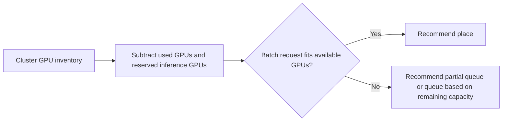

# GPU Capacity Binpacker

Suggests GPU placement decisions for ML workloads while preserving headroom for online inference.

Focus: GPU platform engineering, capacity planning, training and inference reliability.

Portfolio framing: Apple-scale client-style AI infrastructure project using synthetic data only.

## Run

```bash
python3 gpu_binpacker.py sample_capacity.csv
```

## Verify

```bash
python3 -m unittest discover . -v
```

## Local verification

Run `make verify` with Make and Python 3 installed. The target runs the documented sample through the project CLI. It also runs the existing Python unit tests.

## Project walkthrough



[Architecture and data flow](docs/ARCHITECTURE.md) · [Business problem, demo, and verification](docs/CASE_STUDY.md)
